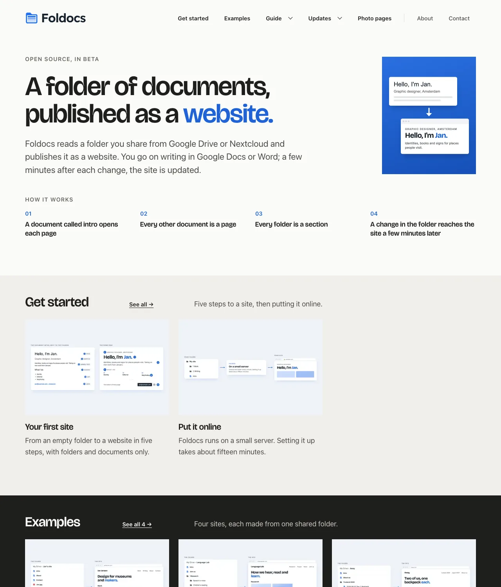
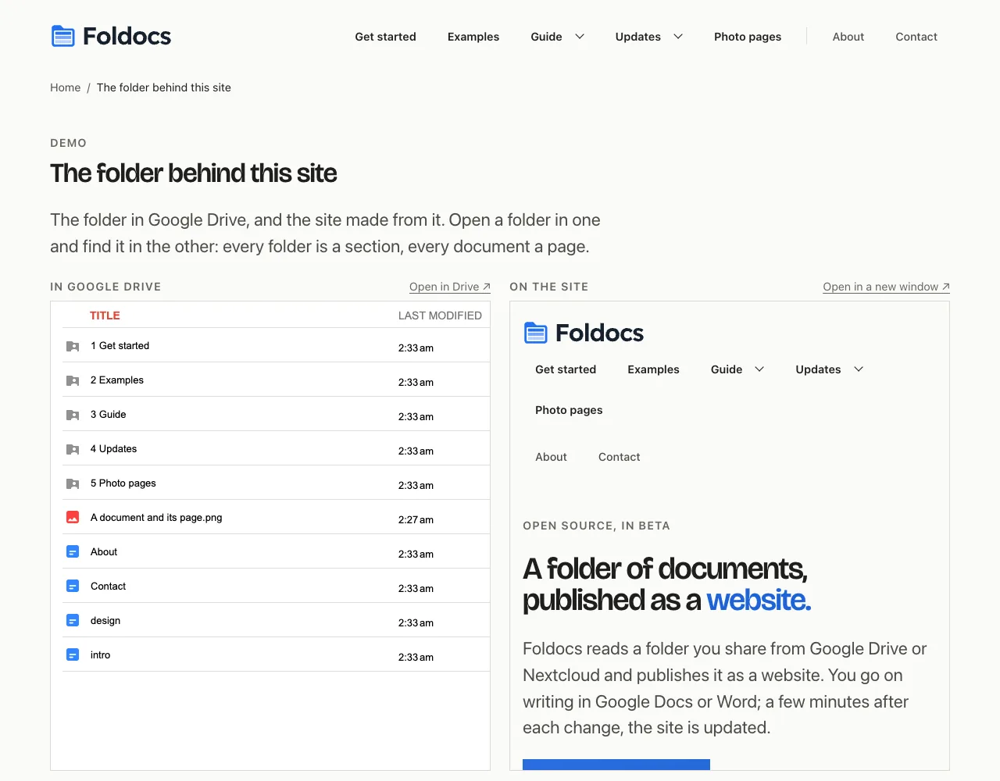
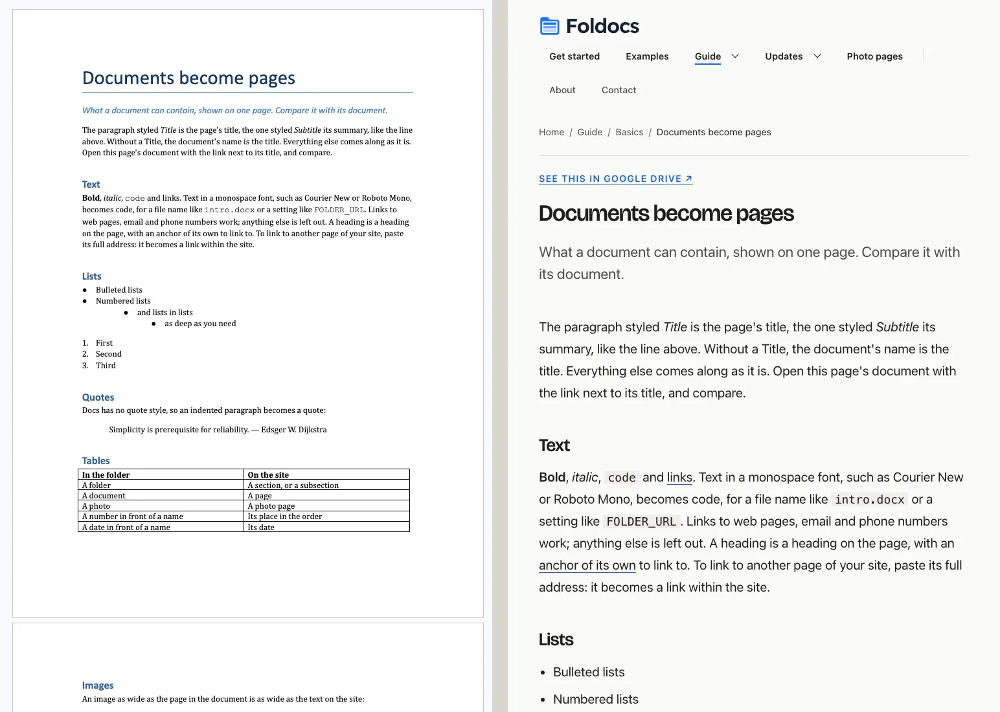
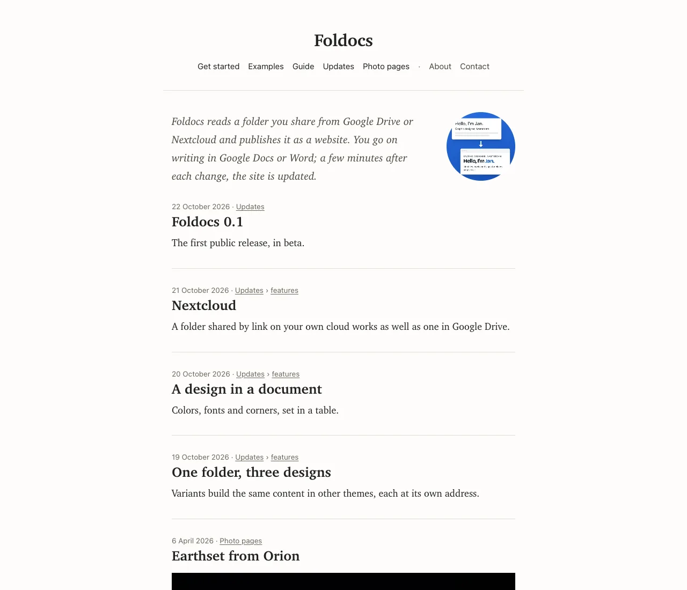
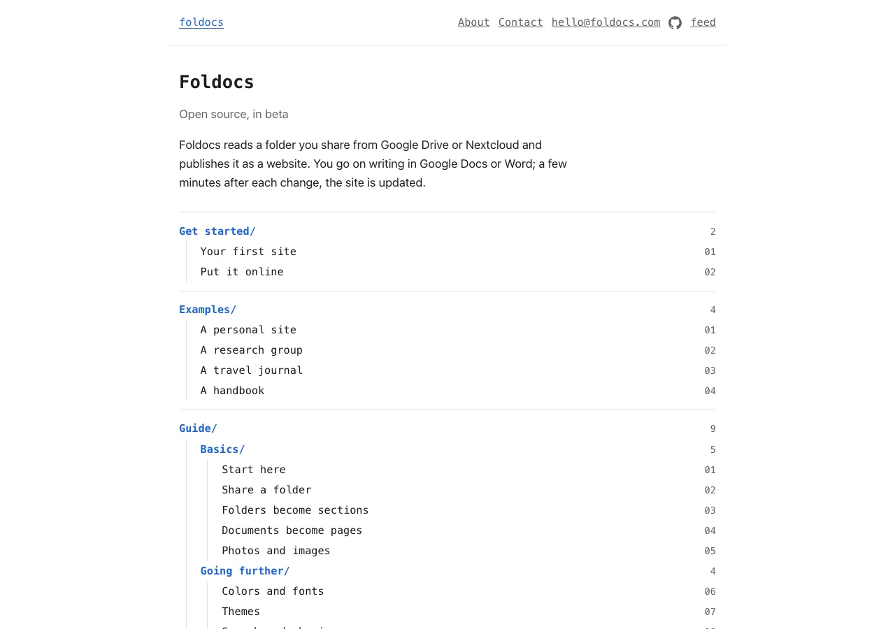
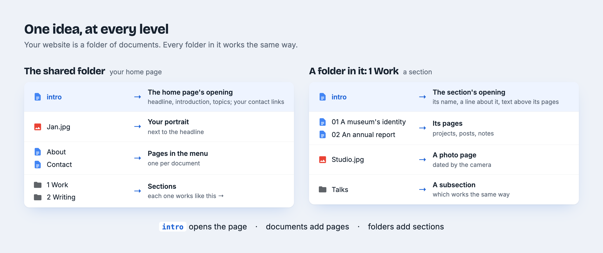
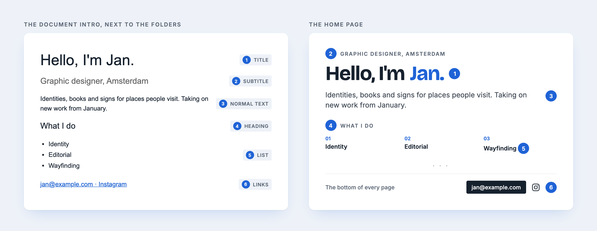
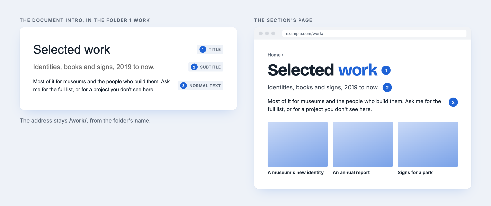

<p align="center">
  <picture>
    <source media="(prefers-color-scheme: dark)" srcset="assets/logo/foldocs-logo-dark.svg">
    
  </picture>
</p>

<p align="center">
  <a href="https://github.com/graus/foldocs/actions/workflows/ci.yml"></a>
</p>

# Foldocs

A folder of documents, published as a website.

Foldocs reads a folder you share from Google Drive or Nextcloud and builds a static website from
it. Documents become pages, folders become sections and photos become photo pages. A small Python
service checks the folder every minute and rebuilds what changed; any web server can host the
result.

Foldocs has no editor or database of its own. The folder is where you write, and the site is a
read-only copy of it. Reading the folder takes only its share link (and, for Drive, an API key),
because the folder is public, as the site is. Sites come with a feed, dark mode, accessible markup
and the metadata search engines use, and themes can present the same folder as a personal site, a
blog or a folder index.

> Foldocs 0.1 is the first release. It runs real sites, but settings and themes may change before
> 1.0.

[foldocs.com](https://foldocs.com) is made with Foldocs, from a public Google Drive folder. It
documents Foldocs, shows that folder [beside the site](https://foldocs.com/demo/), and links each
page to its document. The same folder is also built [as a blog](https://journal.foldocs.com) and
[as a folder tree](https://index.foldocs.com).

<picture>
  <source media="(prefers-color-scheme: dark)" srcset="assets/screenshots/home-dark.webp">
  
</picture>

The Drive folder beside the site, and a Google Doc beside the page made from it:

<picture>
  <source media="(prefers-color-scheme: dark)" srcset="assets/screenshots/drive-beside-site-dark.webp">
  
</picture>

<picture>
  <source media="(prefers-color-scheme: dark)" srcset="assets/screenshots/doc-and-page-dark.webp">
  
</picture>

The same folder in the other two bundled themes, as a blog and as a folder tree:

<table><tr>
<td><picture>
  <source media="(prefers-color-scheme: dark)" srcset="assets/screenshots/variant-journal-dark.webp">
  
</picture></td>
<td><picture>
  <source media="(prefers-color-scheme: dark)" srcset="assets/screenshots/variant-index-dark.webp">
  
</picture></td>
</tr></table>

## The idea

Every folder in the shared folder works the same way, the shared folder itself included:

- **A document called `intro` opens the folder's page.** In the shared folder, that is your home
  page: its headline, introduction and topics, and your contact links. In a folder in it, that
  section's page.
- **Every other document adds a page.** Next to your folders, a page in the menu, like About or
  Contact. In a folder, one of its pages: a post, a project, a note.
- **Every folder adds a section**, with a page of its own and a row on the home page. A folder in
  a folder is a subsection, and works the same way again; the menu lists a section's subsections
  under it.
- **A photo** next to your folders is your portrait; in a folder, a photo page of its own.



One more name: a document called `design`, next to your folders, sets your colors and fonts.
Neither `intro` nor `design` is a page itself; write both in lowercase, so they stand out among
your pages (Foldocs ignores case).

## Quick start

You need a folder shared with a link, in Google Drive or Nextcloud ([The folder](#the-folder)),
and Python 3.13 with [uv](https://docs.astral.sh/uv/), or Docker ([Deployment](#deployment)).

```sh
git clone https://github.com/graus/foldocs && cd foldocs
uv sync
cp .env.example .env                    # fill in FOLDER_URL, SITE_URL, AUTHOR (and GOOGLE_API_KEY for Drive)
uv run --env-file .env foldocs sync     # fetch the folder and build the site into data/public
uv run --env-file .env foldocs serve    # preview at http://localhost:8000
```

`foldocs loop` keeps the site up to date (what the Docker service runs); `foldocs build`
rebuilds from the cache after a theme change; `foldocs check-theme <folder>` checks a theme.

## Your first site, step by step

Start with an empty folder in Google Drive or Nextcloud. Five steps make it a website, following
[the idea](#the-idea) above.

**1. Share the folder.** Google Drive: *Share → General access → Anyone with the link*, as
*Viewer*. Nextcloud: a read-only *Share link*. Copy the link; it is the one setting Foldocs needs
to find the folder (`FOLDER_URL`, see [The folder](#the-folder)).

**2. Put a document called `intro` in it.** This document is the top of your home page. Use the
paragraph styles from the style menu (*Normal text ▾* in Google Docs, the *Styles* gallery in
Word):

| In the shared folder's `intro` | On the home page |
|---|---|
| A line in the **Title** style | The big headline: *Hello, I'm Jan.* |
| A line in the **Subtitle** style | The small label above it: *Graphic designer, Amsterdam* |
| A normal paragraph | The introduction under the headline |
| A bulleted list (optional) | Numbered topics under it; a heading right above the list names them |
| Links to your email and profiles (optional) | Not at the top, but in every page's footer: see below |



**Your contact links** go in the `intro` too, anywhere in it, say as a last line:
*jan@example.com · LinkedIn · Instagram*, each a link. They don't show at the top, but at the
bottom of every page: the first email link as a button, links to your profiles as their logos.
Foldocs recognizes LinkedIn, Bluesky, X, Instagram, Threads, Facebook, Mastodon, GitHub, GitLab,
YouTube, Vimeo, TikTok, Behance, Dribbble, Medium, Substack, ORCID and Google Scholar; other links
stay in the `intro` only. No email link, no button: your address is on the site only if you put
it there.

Put a photo (JPG, PNG, HEIC, WebP or GIF) next to it, and it is the portrait beside the headline
(the newest photo, if there are more). Any other document next to it is a page in the menu, after
the sections, with an address from its name: `About` at `/about/`, `Contact` at `/contact/`.

**3. Add a folder per section.** Each one is a row on the home page, a page of
its own and an item in the menu: `1 Work`, `2 Writing`. The number sets the order and isn't
shown. An `intro` document in a section is optional and opens its page:

| In a section's `intro` | On the section's page |
|---|---|
| A line in the **Title** style | The section's name, instead of the folder's |
| A line in the **Subtitle** style | The line under it, also under its row on the home page, and its description for search engines |
| The rest | Text above the section's pages: what's in it, and why. Its first image is the section's picture in link previews |



The folder's name still makes the section's address (`/work/`), so retitling the `intro` breaks no
links. A folder in a section can have an `intro` too.

**4. Add documents to a section.** Each document is a page: its **Title** line is the page's
title, its **Subtitle** line the summary on its card, and the rest the page itself, with headings,
lists, links and tables. A link to another document, photo or folder in your folder (a Doc's
address, or a path such as `../Trip/Day one.md` in a Markdown or Word file) leads to its page on
the site.

**5. Add images.** Two ways, for two things:

- **In a document** (*Insert → Image*): the image is on that page, as wide as you made it in
  the document. The first image is also the page's picture on its card and in link previews.
- **As a file in a section folder**: the photo gets a page of its own, dated by when it was
  taken, and shows up in the section's row like a document.

The whole structure, with everything optional:

```
My site/                       shared: anyone with the link can view
├── intro                      the home page's opening, and your contact links
├── 1 About                    /about/    ┐ any other document here: a page in the menu,
├── 2 Contact                  /contact/  ┘ after the sections; a number sets the order
├── design                     colors and fonts (see Themes)
├── me.jpg                     the portrait: the newest photo here
├── 1 Work/                    a section: a row on the home page, a page, a menu item
│   ├── intro                  its name (Title), a line (Subtitle), text above its pages
│   ├── 01 First project       numbered files keep their order
│   └── 02 Second project
└── 2 Writing/                 the next section; newest first
    ├── 2024-05-01 Old post    a date in front backdates a file
    ├── A new post             dated by when it went into the folder
    └── Essays/                a folder in a folder: a subsection, nested as deep as you like
```

- **Order.** A number in front of a name sets the order and isn't shown: a folder whose files are
  all numbered keeps their order, any other shows its newest files first, dated. On the home page
  a section is a row of its first three pages, with a link to the rest.
- **Documents** are Google Docs, Word files (`.docx`) or Markdown files (`.md`). They keep their
  headings, lists, links, tables, footnotes (not in Markdown) and images; an indented paragraph
  becomes a quote, and text in a monospace font (or Word's *HTML Code* style) becomes `code`. In
  Markdown, a `#` heading that opens the file is its Title (or front matter's `title:`, with
  `subtitle:` or `description:`), and an image is another file in the folder, linked by its path:
  ``.
- **Photos** are dated by when they were taken and captioned by their description where the
  service has one. Drawings and diagrams are fitted rather than cropped.
- **Hidden files and folders**, whose names start with a dot, are not on the site; a Markdown
  file can still show the images in one.
- **Everything else in the folder is on the site**, about five minutes after you last touched a
  file (Foldocs waits, so that an edit in progress isn't published). Keep drafts elsewhere.

The site never links to the folder (image addresses hide file IDs), except where a theme does on
purpose, like the default theme's demo page.

## The folder

The folder can live in any of these services. Whichever it is, you give Foldocs its share link,
as the Share dialog gives it, in `FOLDER_URL`: Foldocs tells the service from the address.
Everything else (the layout of the folder, the themes, the deployment) is the same.

### Google Drive

1. In Drive, share the folder: **Anyone with the link**, as **Viewer**, and copy the link
   (`https://drive.google.com/drive/folders/…`) into `FOLDER_URL`; the folder's ID alone works
   too. Work and school accounts may not allow this; a personal account does.
2. In the [Google Cloud console](https://console.cloud.google.com/), create a project (no billing
   needed), enable the **Google Drive API**, and create an **API key** restricted to it. It goes
   in `GOOGLE_API_KEY`. With `gcloud`, the key is the `keyString` in the last command's output:

```sh
gcloud projects create my-site-drive
gcloud services enable drive.googleapis.com apikeys.googleapis.com --project my-site-drive
gcloud services api-keys create --project my-site-drive --display-name site \
  --api-target=service=drive.googleapis.com
```

Pages are Google Docs, or Word or Markdown files uploaded as they are. The default theme has a
demo page with the folder beside the site and a page on how it works.

### Nextcloud

Share the folder with a **Share link**, read only. The link (`https://your-cloud/s/…`) goes in
`FOLDER_URL`, and its password, if you gave it one, in `FOLDER_PASSWORD`. No
account or key is needed. Pages are Word files (`.docx`) or Markdown files (`.md`), as the Text
app writes them: the images you paste into one are kept in a hidden folder beside it, and show on
its page. Compared with Drive:

- **Files only.** OpenDocument files (`.odt`) are skipped, so set Collabora or OnlyOffice to
  save as `.docx`.
- **No captions.** Photos have no descriptions to caption them with.
- **Dates.** An undated file gets its creation time, or failing that its upload time.
- **Links.** A link to a page's source opens the share at the file's folder.
- **No demo or how-it-works page.** The default theme's two pages explain a Drive folder, so a
  site made from a share goes without them.

### Other services

Foldocs doesn't read OneDrive or Dropbox. Unlike Drive and Nextcloud, neither lets a shared
folder be read without an account: both need an app registered with the service and a login.
Adding a service is one module in [`foldocs/sources/`](foldocs/sources/__init__.py), which
describes what it must do. Adding a kind of document is one module in
[`foldocs/formats/`](foldocs/formats/__init__.py): it reads the file into clean HTML, and the rest
is the same for every format.

## Configuration

Settings are environment variables, from `.env` (all of them are in `.env.example`):

| Variable | | |
|---|---|---|
| `FOLDER_URL` | required | The folder's share link, from Drive or Nextcloud |
| `SITE_URL`, `AUTHOR` | required | The site's address, and whose site it is |
| `FOLDER_PASSWORD` | | The share link's password, if it has one (Nextcloud) |
| `GOOGLE_API_KEY` | Drive | A Google API key (the same for every folder) |
| `THEME_DIR` | | The theme (default: the bundled `default`) |
| `TIMEZONE` | | For dates (default `Europe/Amsterdam`) |
| `NOINDEX` | | `1` keeps the site out of search results, for a preview |
| `DATA_DIR` | | Where the cache and the built site go (default `data`) |

## Themes

A theme is a folder of Jinja templates, static files and a `theme.toml` with its addresses and
words; the engine has no look or language of its own. Three come with it:

| Theme | Presents the folder as |
|---|---|
| `default` | A personal site: headline and intro, then a row per section on alternating bands |
| `journal` | A blog: one column, newest first, an archive by folder |
| `index` | The folder tree itself |

All three extend **`base`**, which holds the page head, feed, sitemap and shared CSS. The engine
fills the head: titles, descriptions, link previews and schema.org structured data, so themes
don't have to. Themes share one set of design tokens (`--color-*`, `--font-*`, `--text-*`,
`--space-*`), and `foldocs check-theme` checks a theme's colors against WCAG AA in light and dark mode.

**Your own theme** usually extends one and overrides only what differs:

```toml
# my-theme/theme.toml
extends = "default"
language = "nl"
stylesheets = ["colors.css"]   # after default's: override a few tokens

[strings]                        # the words the templates use; translate the ones you show
see_all = "Alles bekijken →"
notice = "Een voorstel: het ontwerp maken we samen af."   # a line atop every page (optional)
```

`themes/base/theme.toml` lists every word: `months` and `home` (the first breadcrumb) at the top,
the rest under `[strings]`.

Templates and static files are looked up in your theme first, then in what it extends; an
inherited extra page is switched off with `template = ""`, and `sources = ["drive"]` keeps one
to sites made from that source (`drive` or `nextcloud`; the default theme's demo and how-it-works
pages explain a Drive folder). In Docker, `THEME_DIR` can be anywhere on the host, as a path
starting with `./` or `/`.

**Small additions** need no templates of their own: in the default theme, `static/logo.svg` (and
`logo-dark.svg`) replaces the name in the header; in any theme, `static/favicon.svg` and
`static/apple-touch-icon.png` become the icons, `static/share.png` (1200×630) is the link preview
of any page without an image of its own, and `templates/_head.html` goes into every page's
`<head>`, for a verification tag, say.

**Variants** show the same site in other designs: each theme in your theme's `variants/` folder
(say `variants/journal/`, extending `journal`) is built too, and served at `journal.<your host>`
with a banner back to the original.

**Your site's design, from the folder.** A document called `design` (it is not a page) next to
your folders changes a few of those tokens without touching a theme. It holds a table, a row per
setting, and an empty cell keeps the theme's value:

| Setting | Light | Dark | |
|---|---|---|---|
| Accent | `#00875a` | `#5fd3a1` | links, buttons, marks |
| Background | `#f6f1e7` | | the page; panels, bands and borders follow |
| Text | | | the text; secondary text follows |
| Heading font | `Fraunces, serif` | | titles and headings |
| Body font | `Lora` | | running text |
| UI font | | | menus, labels, dates |
| Corners | `8px` | | rounding of images, cards and buttons |

The first row is a header (unless it names a setting). Colors are hex; *Dark* is for visitors
in dark mode, and empty there keeps the theme's dark value. A font is a family on
[Google Fonts](https://fonts.google.com), by name or by the link to its page: it is downloaded
with the document and served by the site itself, so visitors' browsers never ask Google. Other
names in the list stay as they are, for whoever has them installed, and a generic family at the
end (`serif`, `sans-serif`, `monospace`) is what shows while the font loads. Every value
is checked against what its setting takes; anything else is logged and skipped, so nothing but a
color, a font name or a length reaches the stylesheet. The same settings apply to every theme
and variant. Your theme can look at them too, as `design`.

## Deployment

With `.env` filled in as in [Quick start](#quick-start), `docker compose up -d --build` runs two
containers: `sync` (the loop, as an unprivileged user) and `web` (Caddy serving the built site).
`web` publishes no port of its own. It joins the Docker network of your reverse proxy (Caddy,
Traefik, nginx), named in `PROXY_NETWORK`, under its project name (`COMPOSE_PROJECT_NAME`); the
proxy handles TLS and the domain. If the network doesn't exist yet, `docker network create
proxy` makes it. With Caddy as the proxy, and a variant called `journal`:

```
example.com, journal.example.com {
	reverse_proxy foldocs:80
}
```

For a private preview, add `basic_auth` there and set `NOINDEX=1`. Without Docker, run
`foldocs loop` as a service and let any web server serve `data/public`: it is a plain static
folder. To publish now rather than in a few minutes, `docker compose restart sync`. The folder
is the only thing to back up.

## Development

```sh
uv run pytest            # engine, every bundled theme rendered and contrast-checked
uv run ruff check . && uv run ruff format .
```

```
foldocs/           cli · config (settings, the two special names)
                   sync (fetch what changed) · cache (its files) · convert (documents to HTML)
                   images (WebP variants) · design (the design document)
                   site (the site as a model) · render (pages, feed, sitemap) · seo
                   contact (email and profiles) · theme · themecheck · text
                   xmlsafe (XML from outside, without a DTD)
foldocs/sources/   what a source does, the services: drive (Drive REST API), nextcloud (WebDAV)
themes/            base, default, journal, index
deploy/            the web container's Caddyfile
assets/            the logo, and this README's drawings and screenshots
```

## Contributing

Issues and pull requests are welcome. Before a pull request, run the tests and the linter (see
[Development](#development)); a change to a theme should keep `foldocs check-theme` passing. To
report a security problem, see [SECURITY.md](SECURITY.md).

## License

Copyright © 2026 David Graus.

- **The engine** (everything outside `themes/`) is under the
  [GNU Affero General Public License v3.0 only](LICENSE). Run it, change it and share it. If you offer a
  changed version to others as a service, you must also offer them its source.
- **The themes** (`themes/`) are under the [MIT license](themes/LICENSE).
  The sites you build don't come under the AGPL, so a theme of your own can use any license.
- **The Bricolage Grotesque font** is under the [SIL Open Font License](themes/default/static/fonts/OFL.txt).
- **The Foldocs name and logo** are not covered by these licenses: a fork is welcome, under a
  name of its own.
