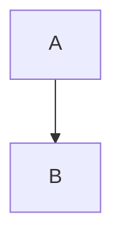

# Project notes

> [!NOTE]
> Useful information that readers should know.

> [!WARNING]
> Critical content demanding attention.

- [x] Done task
- [ ] Open task
  - [ ] Nested task

| Left | Center | Right |
|:-----|:------:|------:|
| a | b | c |
| `x \| y` | **bold** | [link](https://example.com) |

A statement with a footnote[^note].

[^note]: The footnote text, by Jan Jansen.

<details>
<summary>Click to expand</summary>

Hidden content inside details.

</details>

https://example.com/autolinked and <https://example.com/angle> and <jan@example.com>.

:tada: an emoji shortcode and 🎉 a real one.

~~strike~~ and ~single tilde~.

```diff
- old line
+ new line
```

Line with two trailing spaces  
and the next line.

Line with a backslash\
and the next.

@jan mentions #12 an issue.

<kbd>Ctrl</kbd>+<kbd>C</kbd>



